<p align="center">
  
</p>

<h1 align="center">Quantum computing, engineered for real systems.</h1>

<p align="center">
  Working across quantum–classical machine learning, quantitative research, and quantum software infrastructure.
</p>

<p align="center">
  <a href="https://openqml.org/">Website</a> &nbsp;·&nbsp;
  <a href="https://pypi.org/project/openqml/">Python package</a> &nbsp;·&nbsp;
  <a href="https://github.com/OpenQML-org/OpenQML">Source code</a>
</p>

---

### Current focus

**01 — Quantum–classical AI**  
Hybrid neural networks across PyTorch, JAX, and Flax, with quantum layers, differentiable circuits, and tensor-network computation.

**02 — Quantitative research**  
Scenario generation, portfolio construction, and risk-aware optimization with explicit transaction costs.

**03 — Quantum programming interoperability**  
Circuit translation between Qiskit, Cirq, PennyLane, and OpenQASM, with semantic checks and backend-aware execution.

### OpenQML

[**OpenQML**](https://github.com/OpenQML-org/OpenQML) is an open-source Python library connecting these three areas through a shared programming and execution interface.

```bash
python -m pip install -U openqml
```

```python
import openqml as oq

circuit = oq.Circuit(2).h(0).cx(0, 1)
result = oq.convert(circuit, target="openqasm3")
print(result.value)
```

[Documentation and research](https://openqml.org/) · [Package on PyPI](https://pypi.org/project/openqml/) · [Explore the repository](https://github.com/OpenQML-org/OpenQML)

---

### Contribution field

<picture>
  <source media="(prefers-color-scheme: dark)" srcset="https://raw.githubusercontent.com/OpenUSA/OpenUSA/output/github-snake-dark.svg" />
  <source media="(prefers-color-scheme: light)" srcset="https://raw.githubusercontent.com/OpenUSA/OpenUSA/output/github-snake.svg" />
  
</picture>

<sub>Generated from the actual GitHub contribution graph · refreshed daily via GitHub Actions</sub>
