<p align="center">
  
</p>

<h1 align="center">Quantum computing, engineered for real systems.</h1>

<p align="center">
  Working across quantum–classical machine learning, quantitative research, and quantum software infrastructure.
</p>

<p align="center">
  <a href="https://openqml.org/">Website</a> &nbsp;·&nbsp;
  <a href="https://pypi.org/project/openqml/">Python package</a> &nbsp;·&nbsp;
  <a href="https://github.com/OpenQML-org/OpenQML">Source code</a>
</p>


```

[Documentation and research](https://openqml.org/) · [Package on PyPI](https://pypi.org/project/openqml/) · [Explore the repository](https://github.com/OpenQML-org/OpenQML)

---

### Contribution field

<picture>
  <source media="(prefers-color-scheme: dark)" srcset="https://raw.githubusercontent.com/OpenUSA/OpenUSA/output/github-snake-dark.svg" />
  <source media="(prefers-color-scheme: light)" srcset="https://raw.githubusercontent.com/OpenUSA/OpenUSA/output/github-snake.svg" />
  
</picture>

<sub>Generated from the actual GitHub contribution graph · refreshed daily via GitHub Actions</sub>
